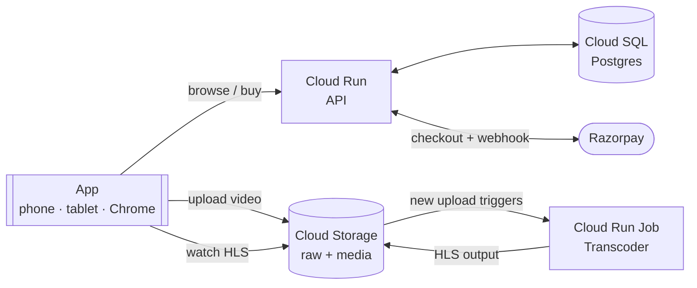
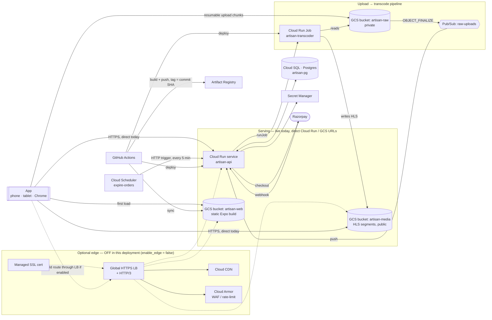

# Makers BTS: handmade products with behind-the-scenes process videos

Artisans list handmade products alongside a process video of up to 15 minutes. Buyers search, watch how the piece was made, and place an order.

- **Platforms:** Android phone, Android tablet, and Chrome, from one codebase.
- **Network target:** video playback stays smooth below 50 kbps.
- **Hosting:** everything runs on Google Cloud.

```
apps/mobile          Expo (React Native + react-native-web) app — Android phone, Android tablet, Chrome
packages/shared      Zod schemas + types shared by app and API
services/api         Fastify API on Cloud Run (search, listings, uploads, orders, webhooks)
services/transcoder  FFmpeg + Shaka Packager on Cloud Run Jobs (AV1/H.264 ladders, CMAF HLS + DASH)
infra/terraform      All GCP infrastructure (Cloud Run, Cloud SQL, GCS, Pub/Sub, LB + Cloud CDN, Armor)
.github/workflows    CI (typecheck, tests, build, terraform validate) and deploy (WIF → GCP)
```

## How it works

At a glance:



In full — every service, the upload→transcode trigger chain, and the optional edge tier:



**The edge tier (global HTTPS load balancer + Cloud CDN + Cloud Armor + managed SSL) was part of the original design** — `api.*`/`media.*`/`app.*` custom domains in front of everything — and the Terraform for it is still in [`infra/terraform/edge.tf`](infra/terraform/edge.tf), gated behind `var.enable_edge`. It's **off** in this deployment: `enable_edge = false` in `terraform.tfvars` skips the LB's fixed cost (~$25–35/mo) and the DNS-propagation wait for a demo/assignment deployment, and the app reaches the API and buckets directly over their own `*.run.app` / `storage.googleapis.com` HTTPS URLs instead — see the `web_base_url`/`media_base_url` locals in [`infra/terraform/main.tf`](infra/terraform/main.tf). Flip `enable_edge = true`, point the `api`/`media`/`web` DNS records at the `lb_ip` Terraform output, and re-apply to turn it on.

Upload: App ──resumable chunks──► GCS raw bucket ─finalize─► Pub/Sub ─push─► API ─runJob─► Transcoder
Order: App ─► API (atomic stock hold) ─► Razorpay ─webhook─► API: PLACED ─► Pub/Sub order-events

### What's actually deployed — good for the GCP walkthrough video
Since the edge tier is off, these are the services to show live to prove "deployed services running the code and handling video transcoding/storage":

| Service | What it does | What to show |
|---|---|---|
| Cloud Run → Services | Runs the API container | `artisan-api`, its public URL, and the image tag (commit SHA — ties to the GitHub Actions deploy) |
| Cloud Run → Jobs | Transcodes each upload | `artisan-transcoder` — open it right after uploading in the demo to show the execution it just ran |
| Cloud Storage | Raw upload + transcoded output | `...-raw` bucket (your original file, private) and `...-media` bucket (public — the HLS `master.m3u8` + variant playlists + segments it just produced) |
| Pub/Sub | Event trigger from upload to transcode | `raw-uploads` topic/subscription — the thing that actually fires the transcoder job, not just "a job ran somehow" |
| Cloud SQL (Postgres) | Listings/orders database | `artisan-pg` instance; the row your demo listing/order just created |
| Secret Manager | Razorpay keys, DB URL | that the secrets/versions exist (don't reveal values on camera) |
| Artifact Registry | Docker images for API + transcoder | the `artisan` repo, images tagged by commit SHA |
| Cloud Scheduler | Releases unpaid stock holds every 5 min | `artisan-expire-orders` job (optional) |
| IAM → Workload Identity Federation | GitHub Actions deploys via OIDC, no exported SA keys | optional, good for a security/architecture note |

Suggested flow for the recording: upload a video in the app → switch to the console → raw bucket → Pub/Sub topic → the transcoder job's execution → the HLS output landing in the media bucket → back to the app to show it playing. That visually proves the whole storage/transcode chain instead of just naming services.

### Playback below 50 kbps
| Rung | Video | + Opus 12 kbps | Measured on a test clip |
|---|---|---|---|
| `av1_l0` | 256×144 @ 12 fps, 24 kbps | ≈ 36 kbps | 23.5 + 9.5 = **33 kbps** |
| `h264_l0` (non-AV1 devices) | 256×144 @ 10 fps, 36 kbps | ≈ 48 kbps | 37.1 + 9.5 = **47 kbps** |

Higher rungs go up to 720p. The full ladder is in `services/transcoder/src/ladder.ts`.

Player settings:
- Starts on the lowest rung, builds a 60 s buffer, and resumes after 2 s.
- Product cards prefetch the first L0 segments while the buyer scrolls.
- A ~90 s highlight reel and an "audio + stills" mode cover the worst links.

### Uploads of any size
- The API hands the client a GCS resumable-upload session. Video bytes never pass through Cloud Run.
- The client uploads in 8 MiB chunks and resumes after drops or app restarts (sessions live for 7 days).
- Duration is checked on the device first. `ffprobe` re-checks it in the transcoder, and that check is authoritative.

### Orders
- `POST /v1/orders` takes an `Idempotency-Key`. Stock is reserved with a conditional `UPDATE … WHERE stock >= n`, so a one-of-one piece can't be sold twice.
- A signed Razorpay webhook marks the order `PLACED` and publishes `order.placed`. Shipping and fulfilment are out of scope.
- Unpaid holds are released every 5 minutes.

## Run locally

Requires Node 22 and Docker. The whole flow runs offline: upload, transcode, search, playback, order.

```bash
npm install
docker compose up -d                            # Postgres 16 + fake-gcs-server (raw and media buckets)
cp services/api/.env.example services/api/.env  # DEV_AUTH=true, buckets on the emulator
npm --workspace services/api run migrate
npm run api:dev                                 # http://localhost:8080
npm run local:media                             # http://localhost:4443, transcodes each finished upload

# apps/mobile/.env.local:
#   EXPO_PUBLIC_API_BASE_URL=http://localhost:8080
#   EXPO_PUBLIC_DEV_AUTH=true
npm run app:web                                 # Chrome, http://localhost:8081
npm run app:android                             # device/emulator (dev build; react-native-video is native)
```

What stands in for GCP locally:

| On GCP | Locally |
|---|---|
| Raw and media buckets, Cloud CDN | fake-gcs-server behind `scripts/local-media.mjs` on `:4443` |
| `OBJECT_FINALIZE` → Pub/Sub → API → Cloud Run Job | `local-media.mjs` runs the same transcoder image with `docker compose run` |
| Razorpay checkout + webhook | With no Razorpay keys, the API confirms the order itself (`/v1/dev/orders/:id/pay`) |

With `DEV_AUTH=true`, the API accepts `Authorization: Bearer dev:<uid>:<artisan|buyer>`, and the app sends a fixed demo-user token when `EXPO_PUBLIC_DEV_AUTH=true`. Sign-in uses Identity Platform (phone OTP + Google); the seam is `apps/mobile/src/auth.ts`.

Note: `react-native-video` and `react-native-razorpay` are native modules. They need an Expo development build (`expo run:android` or EAS Build), not Expo Go.

## Deploy to GCP

1. Create the project, an Artifact Registry repo, and a Workload Identity Federation provider for GitHub Actions. Set the repo variables listed in `.github/workflows/deploy.yml`.
2. Bootstrap order: push the first API and transcoder images, then apply Terraform. Cloud Run needs an image to exist.
   ```bash
   cd infra/terraform
   cp terraform.tfvars.example terraform.tfvars   # fill in
   terraform init
   terraform apply -target=google_project_service.enabled -target=google_artifact_registry_repository.images
   # build + push services/api and services/transcoder images (see deploy.yml), then:
   terraform apply
   ```
3. Add secrets:
   ```bash
   gcloud secrets versions add artisan-razorpay-key-secret --data-file=-
   gcloud secrets versions add artisan-razorpay-webhook-secret --data-file=-
   ```
4. Point the `api`, `media` and `app` DNS records at the `lb_ip` output. Run migrations against Cloud SQL, for example via the Cloud SQL Auth Proxy with `npm --workspace services/api run migrate`.
5. In the Razorpay dashboard, point the webhook (`payment.captured`, `payment.failed`) to `https://<api_domain>/v1/webhooks/razorpay`.

After that, every push to `main` builds and deploys the API, the transcoder job, and the web app.

## Status and next steps
See [`docs/roadmap.md`](docs/roadmap.md).
